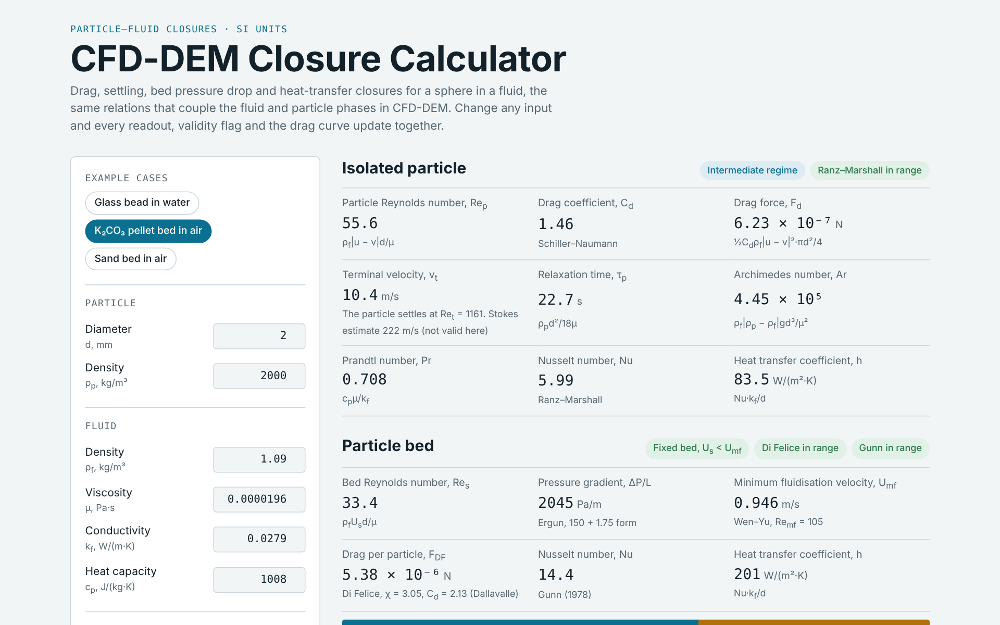

# CFD-DEM Closure Calculator

An interactive calculator for the particle–fluid closures that couple the fluid and particle phases in CFD-DEM: drag, terminal settling, bed pressure drop, minimum fluidisation and particle–fluid heat transfer. Change any input and every readout, validity flag and the drag curve update together.

**Live version:** https://khuramwalayat.github.io/cfd-dem-closure-calculator/



## What it computes

| Quantity | Correlation | Notes |
|---|---|---|
| Drag coefficient, isolated sphere | Schiller & Naumann (1933) | Re < 1000, then Cd = 0.44 |
| Terminal velocity | Force balance with Schiller–Naumann drag | Solved by bisection, valid in every regime; Stokes estimate shown for comparison |
| Particle relaxation time, Archimedes number | Definitions | |
| Heat transfer, isolated sphere | Ranz & Marshall (1952) | Flagged above Re = 200 |
| Bed pressure gradient | Ergun (1952) | Viscous and inertial terms shown separately |
| Minimum fluidisation velocity | Wen & Yu (1966) | Flags when the bed would fluidise |
| Drag in a suspension or bed | Di Felice (1994) with Dallavalle Cd | Flagged outside 10⁻² < Re < 10⁴ |
| Heat transfer in a bed | Gunn (1978) | Flagged for ε < 0.35 |

### Di Felice vs Ergun cross-check

For a fixed bed, the Di Felice drag summed over all particles should balance ε times the Ergun pressure gradient, n·F = ε·(ΔP/L), with n = 6(1 − ε)/(πd³). The factor ε appears because the particles also carry the pressure-gradient (buoyancy) force, which accounts for the remaining (1 − ε) share of the pressure drop. The calculator reports how closely the two closures agree, which shows when a CFD-DEM code should switch drag model for dense beds.

## Validation

`test/closures.test.js` checks the physics core against:

- Ergun viscous and inertial terms calculated by hand for a 2 mm bed in air
- Di Felice drag summed over the bed against ε × Ergun (agreement within 5%)
- the Gunn Nusselt number calculated by hand
- the Stokes limit of the terminal velocity (10 µm glass bead in water)
- the Newton limit, Cd = 0.44 (20 mm steel sphere in air)
- the force balance between drag and buoyant weight at the terminal velocity
- the Wen–Yu minimum fluidisation velocity for 0.5 mm glass beads in water

Run the tests with Node.js 18 or newer:

```
node --test
```

## Running locally

Open `index.html` in a browser. The physics lives in `closures.js`, which also works as a Node module.

## References

1. Schiller, L. & Naumann, A. (1933). Z. Ver. Dtsch. Ing. 77, 318–320.
2. Dallavalle, J. M. (1948). Micromeritics. Pitman, New York.
3. Di Felice, R. (1994). The voidage function for fluid–particle interaction systems. Int. J. Multiphase Flow 20, 153–159.
4. Ergun, S. (1952). Fluid flow through packed columns. Chem. Eng. Prog. 48, 89–94.
5. Wen, C. Y. & Yu, Y. H. (1966). A generalized method for predicting the minimum fluidization velocity. AIChE J. 12, 610–612.
6. Ranz, W. E. & Marshall, W. R. (1952). Evaporation from drops. Chem. Eng. Prog. 48, 141–146 and 173–180.
7. Gunn, D. J. (1978). Transfer of heat or mass to particles in fixed and fluidised beds. Int. J. Heat Mass Transfer 21, 467–476.

## Author

Khuram Walayat, PhD. Computational engineer working on CFD-DEM, peridynamics-DEM and multiphysics simulation ([Google Scholar](https://scholar.google.com/citations?user=ARLxTI4AAAAJ)). Physics specification and validation tests by the author; interface code written with AI assistance (Claude).

## Licence

MIT. See [LICENSE](LICENSE).
